<div align="center">

# ฅ^•ﻌ•^ฅ Felinora-shell

**Hyprland için siyah, kedi temalı, [Quickshell](https://quickshell.org) ile yazılmış bir masaüstü shell'i.**

*A dark, cat-themed desktop shell for Hyprland, built with Quickshell. (UI language: Turkish)*

</div>

---

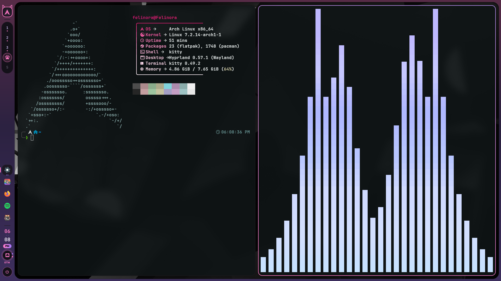

<table>
  <tr>
    <td>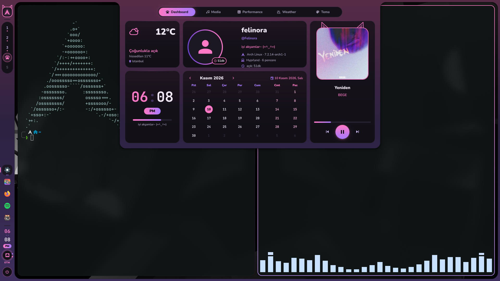<br><sub><b>Dashboard</b> — hava, profil, saat, takvim, medya</sub></td>
    <td>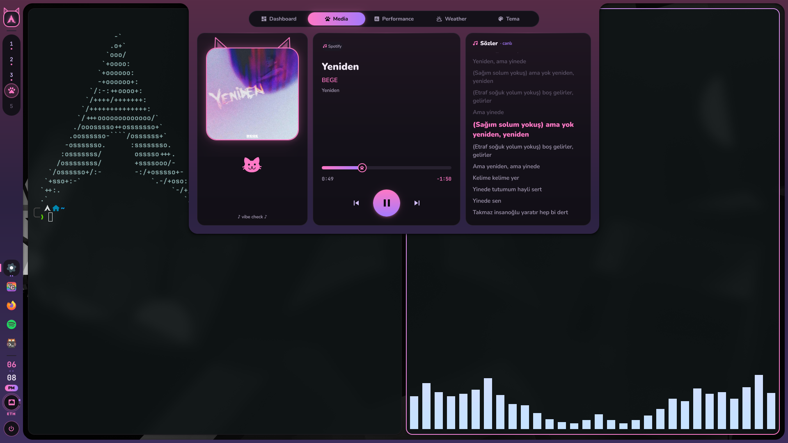<br><sub><b>Media</b> — senkron şarkı sözleri</sub></td>
  </tr>
  <tr>
    <td>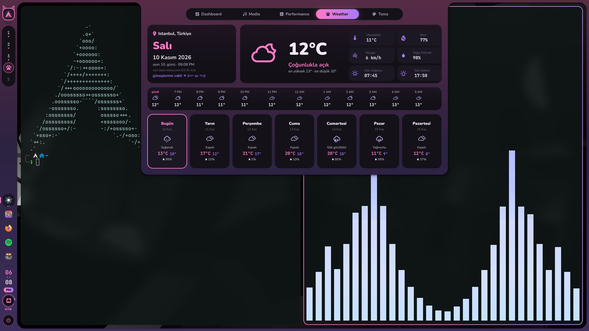<br><sub><b>Weather</b> — saatlik ve 7 günlük tahmin</sub></td>
    <td>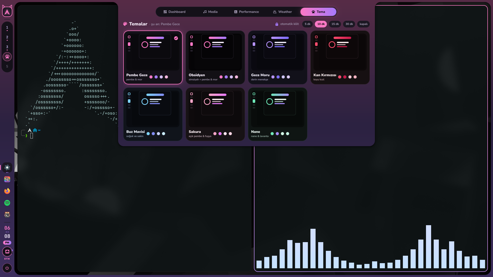<br><sub><b>Temalar</b> — 7 koyu tema, tek tık</sub></td>
  </tr>
  <tr>
    <td>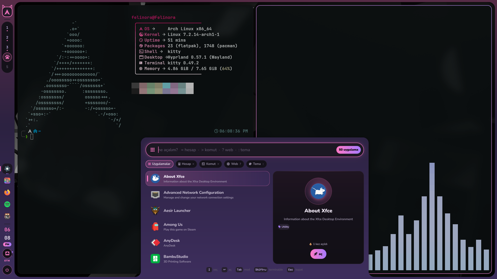<br><sub><b>Program başlatıcı</b> — arama, hesap makinesi, komut, web</sub></td>
    <td>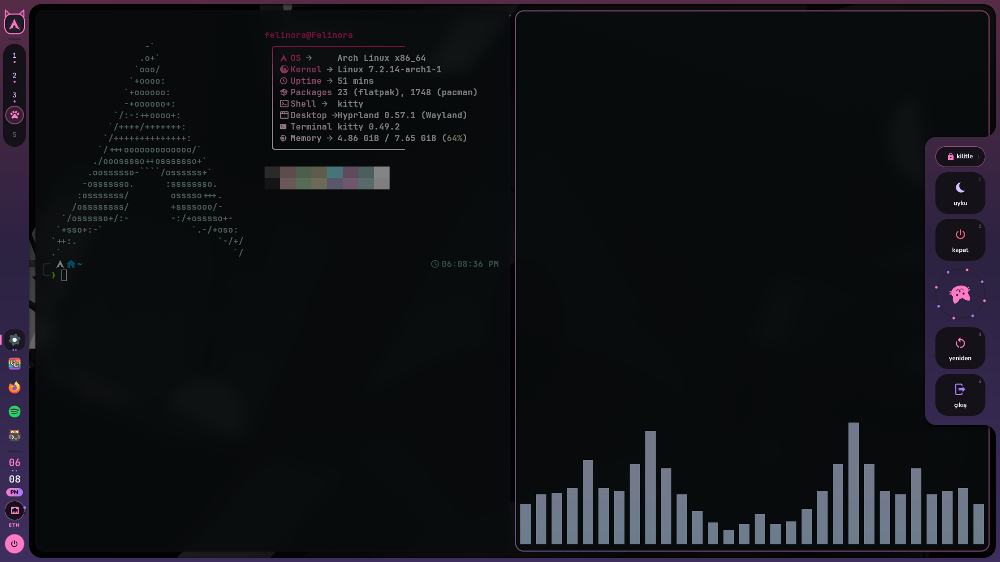<br><sub><b>Çıkış menüsü</b></sub></td>
  </tr>
  <tr>
    <td colspan="2">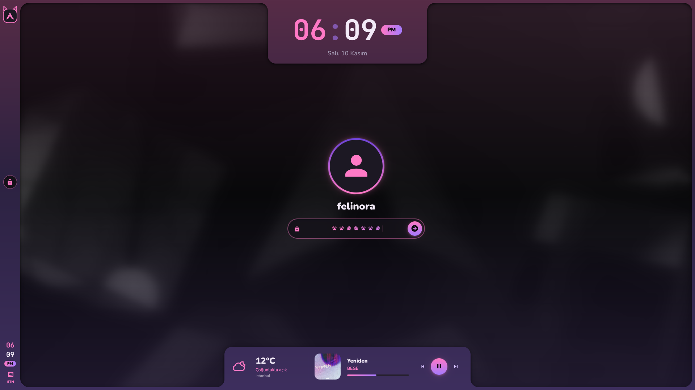<br><sub><b>Kilit ekranı</b> — şifre yazarken patiler</sub></td>
  </tr>
</table>

<details>
<summary><b>🎨 Diğer temalar</b></summary>

| Gece Moru | Kan Kırmızısı | Buz Mavisi |
|---|---|---|
| 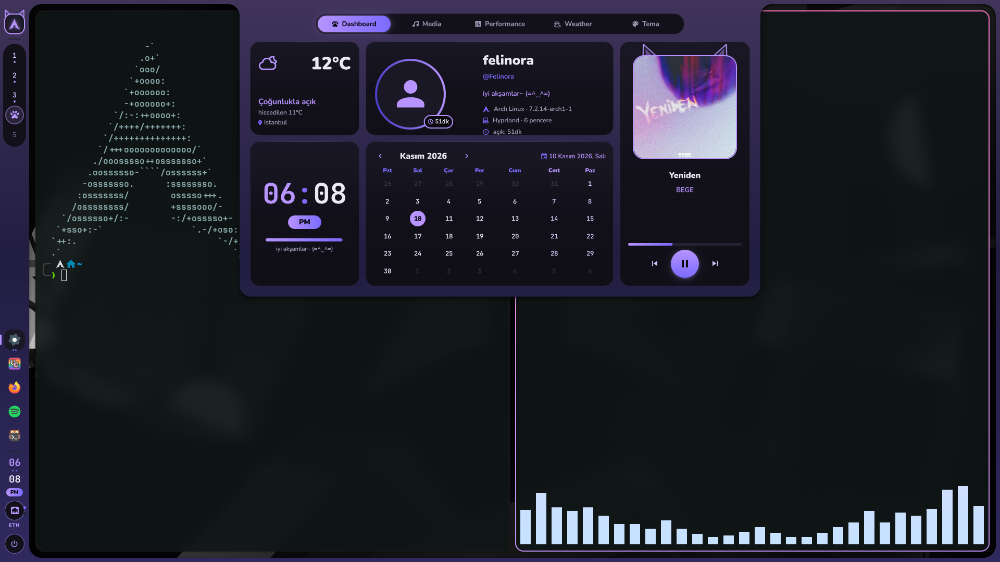 | 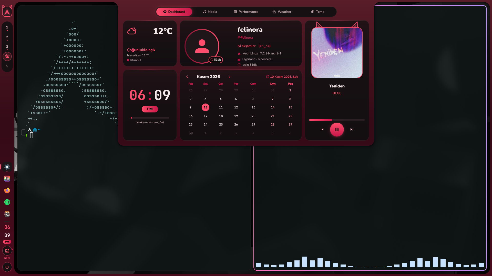 | 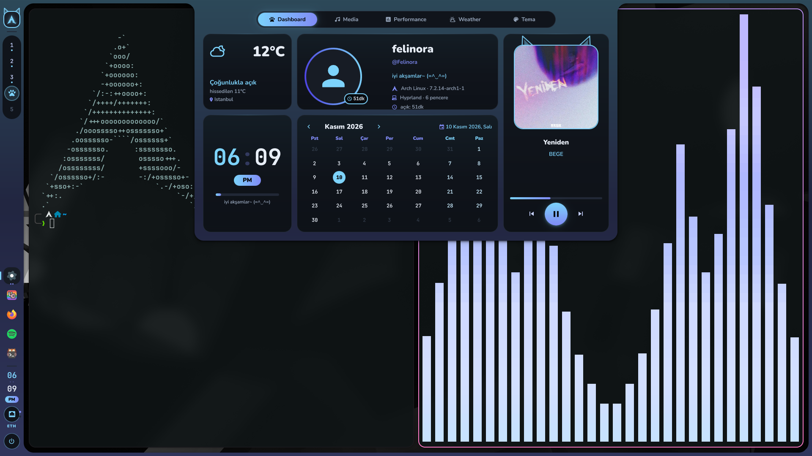 |

</details>

## ✨ Özellikler

- **Tek parça çerçeve** — sol bar ve ekran kenarları tek bir şekil; tüm menüler bu çerçeveden ters yuvarlak köşelerle büyüyerek çıkar.
- **Sol bar** — dağıtımına göre değişen logo, 5 workspace (aktif olanı maskot gösterir; special workspace'te bulanıklaşır), açık uygulamalar (üzerine gelince **canlı pencere önizlemesi** + pencere ayarları), 12 saatlik saat, internet durumu, güç menüsü.
- **Dashboard** (ekranın üst ortasına gel) — 5 sekme:
  - *Dashboard:* hava, profil resmi, çalışma süresi, medya, saat, takvim
  - *Media:* kapak, zaman çizgisi, **senkron şarkı sözleri** ([lrclib](https://lrclib.net))
  - *Performance:* CPU, GPU (NVIDIA / AMD), RAM, disk seçimi, ağ grafikleri
  - *Weather:* anlık + saatlik + 7 günlük tahmin
  - *Tema:* 7 hazır koyu tema + çalan şarkının albüm kapağından renk alan **Şarkı** teması, tek tıkla geçiş, otomatik kilit süresi
- **Program başlatıcı** — bulanık arama, en sık kullanılanlar önde, detay kartı ve modlar: `=` hesap makinesi · `>` komut · `?` web araması · `:` tema
- **Dosya yöneticisi** — temalı, ızgara/liste görünümü, önizleme paneli, sürükle-bırak, "Birlikte aç" (komut yazarak açma dahil), dosya gizleme, şifreli kasalar (gocryptfs vb.) için ayrı bölüm (aşağıya bak)
- **Kilit ekranı** — PAM ile şifre, bulanık duvar kağıdı, şifre yazarken animasyonlar, hareketsizlikte otomatik kilit
- **Çıkış menüsü** — kilitle · uyku · kapat · yeniden başlat · çıkış
- **Hyprland'in hem klasik `hyprland.conf` hem de yeni Lua config'iyle çalışır** (otomatik algılanır).

## 📦 Gereksinimler

| Zorunlu | |
|---|---|
| [Hyprland](https://hyprland.org) | |
| [Quickshell](https://quickshell.org) ≥ 0.3 | Arch: `pacman -S quickshell` |
| Qt 6 (`qt6-svg`, `qt6-declarative`) | genelde Quickshell ile gelir |
| Fontlar: **Nunito**, **JetBrainsMono Nerd Font** | Arch: `ttf-nunito`, `ttf-jetbrains-mono-nerd` |

| İsteğe bağlı | Ne için |
|---|---|
| NetworkManager (`nmcli`) | internet paneli |
| `wl-clipboard` | hesap makinesi sonucunu kopyalama |
| `awww` veya `swww` | kilit ekranı arka planı |
| `nvidia-smi` / amdgpu sürücüsü | GPU bilgisi |
| `pciutils` (`lspci`) | GPU adı |
| `papirus-icon-theme` | uygulama ve dosya ikonları |
| `glib2` (`gio`), `xdg-utils` | dosya yöneticisi: çöp kutusu, "Birlikte aç" |
| `cava` | ses görselleştirici tema eşlemesi |
| `qt6ct` | Qt/KDE uygulamaları (Dolphin vb.) tema eşlemesi |
| `kitty` | varsayılan terminal (ayardan değiştirilebilir) |

## 🚀 Kurulum

```sh
git clone https://github.com/realFelinora/felinora-shell.git
cd felinora-shell
./install.sh
```

`install.sh` Hyprland config'ine **dokunmaz**; eklemen gereken satırları ekrana yazar. Kısaca:

**hyprland.conf**
```ini
exec-once = quickshell -c felinora-shell
bind = SUPER, M, exec, qs -c felinora-shell ipc call felinora launcher
bind = SUPER, L, exec, qs -c felinora-shell ipc call felinora session
```

**hyprland.lua**
```lua
hl.on("hyprland.start", function() hl.exec_cmd("quickshell -c felinora-shell") end)
hl.bind("SUPER + M", hl.dsp.exec_cmd("qs -c felinora-shell ipc call felinora launcher"))
hl.bind("SUPER + L", hl.dsp.exec_cmd("qs -c felinora-shell ipc call felinora session"))
```

## ⚙️ Ayarlar

`~/.config/felinora-shell/config.json` (kurulumda `config.example.json`'dan oluşturulur):

| Alan | Açıklama |
|---|---|
| `terminal` | uygulamaların ve `>` komutlarının açılacağı terminal |
| `networkSettings` | internet panelindeki "Ağ ayarları" butonunun açtığı program |
| `images.workspace` | aktif workspace göstergesi |
| `images.special` | special workspace maskotu |
| `images.spin` | çıkış menüsünde dönen / müzikle sallanan maskot |
| `images.sleep` | boş durumlar (müzik yok, sonuç yok...) |
| `images.avatar` | profil resmi seçilmemişse gösterilecek resim |
| `weather.city` | boşsa konum IP'den bulunur |
| `kitty.sync` | kitty renklerini temayla eşle (aşağıya bak) |
| `fastfetch.sync` | fastfetch ayarını temayla eşle (aşağıya bak) |
| `cava.sync` | cava renklerini temayla eşle (aşağıya bak) |
| `qt.sync` | Qt/KDE uygulamalarının renklerini temayla eşle (aşağıya bak) |
| `files.alwaysHidden` | dosya yöneticisinde **hiç** görünmeyecek yollar (aşağıya bak) |
| `files.pinnedApps` | "Birlikte aç"ta dosya türü ne olursa olsun hep görünen uygulamalar |

**Resimler pakette yoktur** — boş bırakırsan yerlerine şık ikonlar çizilir. Kendi maskotunu koymak için yolları yaz (`~/` desteklenir), kare ve arka planı şeffaf PNG/SVG en iyisidir.

Tema, otomatik kilit süresi, profil resmi ve disk seçimi dashboard'dan yapılır ve `~/.local/state/felinora-shell/` altında saklanır.

## 🐱 Kitty ve fastfetch

İsteğe bağlı: `config.json`'da açarsan terminal de temayla birlikte değişir.

```json
"kitty":     { "sync": true },
"fastfetch": { "sync": true }
```

**Kitty:** Shell `~/.config/kitty/felinora-theme.conf` dosyasını yazar. Bu dosyada yarı saydam "liquid glass" zemin, yuvarlak sekmeler ve temaya göre tonlanmış 16 renk var. Tema değişince açık pencerelerdeki renkler 0,5 saniyede yumuşakça geçer. Bunun için `kitty.conf` dosyasının **sonuna** şunları ekle:

```conf
include felinora-theme.conf

# tema değişince renkler yumuşak geçsin (yalnızca kendi runtime klasöründeki soket)
allow_remote_control socket-only
listen_on unix:${XDG_RUNTIME_DIR}/kitty-{kitty_pid}
```

Uzaktan kontrolü açmak istemezsen son iki satırı yazma. Bu durumda renkler yumuşak geçmez, bir anda değişir. Bu satırları ekledikten sonra açılan kitty pencereleri yumuşak geçişi destekler.

**Fastfetch:** Shell `~/.config/fastfetch/config.jsonc` dosyasını yazar. Bilgiler sistem, donanım ve masaüstü bölümlerine ayrılır; doluluk çubukları ve temanın renkleri kullanılır. İlk seferde önceki ayarın `config.jsonc.felinora-yedek` olarak saklanır. Kitty eşlemesi de açıksa ekrana zaten yazılmış fastfetch çıktısı bile tema değişince yeni renge geçer. Bunun için kitty'nin 17–30 numaralı renkleri kullanılır.

Her yeni terminalde fastfetch otomatik çıksın istersen `~/.zshrc` dosyasının **en başına** ekle (Powerlevel10k kullanıyorsan uyarı vermemesi için instant prompt'tan önce):

```sh
if [[ -o interactive && -n $KITTY_WINDOW_ID && $FASTFETCH_SHOWN != "$KITTY_PID-$KITTY_WINDOW_ID" ]]; then
  export FASTFETCH_SHOWN="$KITTY_PID-$KITTY_WINDOW_ID"
  command -v fastfetch >/dev/null && fastfetch
fi
```

## 🎵 cava ve Qt uygulamaları

```json
"cava": { "sync": true },
"qt":   { "sync": true }
```

**cava:** `~/.config/cava/config` temanın renklerinde degrade çubuklarla yeniden yazılır (ilk seferde eskisi `config.felinora-yedek` olur). Tema değişince açık cava'nın renkleri de yumuşakça geçer.

**Qt / KDE (Dolphin vb.):** Shell `~/.config/qt6ct/colors/felinora.conf` renk şemasını ve KDE için `~/.local/share/color-schemes/Felinora.colors` + `~/.config/kdeglobals` renklerini yazar. Bunun için ortamda `QT_QPA_PLATFORMTHEME=qt6ct` olmalı. Dolphin'de kendi seçtiğin bir renk şeması varsa (`~/.config/dolphinrc` → `ColorScheme`) onu kaldır. qt6ct değişikliği birkaç saniye sonra fark ettiği için Qt uygulamalarında geçiş yumuşak olmaz, tek seferde olur.

## 📁 Dosya yöneticisi

```sh
qs -c felinora-shell ipc call felinora files ""          # aç/kapat
qs -c felinora-shell ipc call felinora files ~/Downloads # belirli klasörde aç
```

- Izgara ve liste görünümü, önizleme paneli, arama (herhangi bir yerde yazmaya başla), sıralama, geri/ileri.
- **Sürükle-bırak:** sol tuşla klasöre sürükle → taşı (Ctrl basılıysa kopyala); sağ tuşla sürükle → bırakınca "taşı / kopyala" menüsü. Sol paneldeki yerlere ve çöpe de bırakılabilir.
- **Birlikte aç:** dosyayı açabilen uygulamalar, `files.pinnedApps` ile hep görünen uygulamalar ve bir komut kutusu (ör. `subl`, `nvim` yazıp Enter; terminal programları kitty'de açılır). "Her zaman bununla aç" varsayılanı değiştirir.
- **Gizle** (sağ tık veya Ctrl+Shift+H): adı klasördeki `.hidden` dosyasına yazılır (Dolphin de okur); Ctrl+H ile görünür.
- **`files.alwaysHidden`:** buraya yazdığın yollar listede hiç görünmez, Ctrl+H ile bile; ama yol çubuğuna (Ctrl+L) yazarak içine girebilirsin. Örnek: `"alwaysHidden": ["~/.config/gizli-klasor"]`
- **Şifreli kasalar:** gocryptfs, cryfs, securefs, encfs ile açılmış klasörler sol panelde ayrı bölümde görünür; yanındaki kilit düğmesi kasayı güvenle kapatır (açık dosya varsa kapatmayı reddeder).

## ⌨️ IPC komutları

```sh
qs -c felinora-shell ipc call felinora dashboard        # dashboard aç/kapat
qs -c felinora-shell ipc call felinora tab weather      # belirli sekme
qs -c felinora-shell ipc call felinora launcher         # program başlatıcı
qs -c felinora-shell ipc call felinora session          # çıkış menüsü
qs -c felinora-shell ipc call felinora network          # internet paneli
qs -c felinora-shell ipc call felinora theme obsidyen   # tema değiştir
qs -c felinora-shell ipc call felinora terminal         # kitty/fastfetch/cava/Qt temasını yeniden yaz
qs -c felinora-shell ipc call felinora files ""         # dosya yöneticisi
qs -c felinora-shell ipc call lock lock                 # kilitle
```

Temalar: `pembe` · `obsidyen` · `gece` · `kan` · `buz` · `sakura` · `nane` · `sarki` (şarkıya göre)

## 🔒 Kilit ekranı hakkında

Şifre kontrolü `assets/pam.d/passwd` dosyasıyla yapılır (sadece `pam_unix`; yanlış denemede hesap kilitlenmez). Kilit ekranı bir sebeple çökerse kurtulabilmek için Hyprland'de `misc:allow_session_lock_restore = true` ayarını öneririm; sonra TTY'den shell'i yeniden başlatıp `qs -c felinora-shell ipc call lock lock` ile kilidi tekrar alabilirsin.

## 🐾 SDDM giriş teması

Shell ile uyumlu giriş ekranı ayrı bir depoda: **[realFelinora/felinora-sddm](https://github.com/realFelinora/felinora-sddm)**

## 🙏 Teşekkürler

- **[caelestia-dots/shell](https://github.com/caelestia-dots/shell)** — çerçeve + çekmece düzeni bu projeden esinlenildi (kod ayrı yazıldı).
- **[Quickshell](https://quickshell.org)** — her şeyin temeli.
- Hava durumu verisi **[Open-Meteo.com](https://open-meteo.com)** ([CC BY 4.0](https://creativecommons.org/licenses/by/4.0/)), konum **[ip-api.com](https://ip-api.com)** (ticari olmayan kullanım), şarkı sözleri **[lrclib.net](https://lrclib.net)**.
- İkonlar **[Nerd Fonts](https://www.nerdfonts.com)**.
- Geliştirme sırasında yapay zekâ asistanı **Claude** (Anthropic) yardımıyla yazıldı.

## 📄 Lisans

Felinora-shell © 2026 **realFelinora**

Bu program özgür yazılımdır: [GNU General Public License v3.0 veya sonrası](LICENSE) koşulları altında dağıtabilir ve/veya değiştirebilirsiniz. Değiştirilmiş sürümler de aynı lisansla, kaynak koduyla birlikte ve orijinal telif bildirimi korunarak dağıtılmalıdır.
